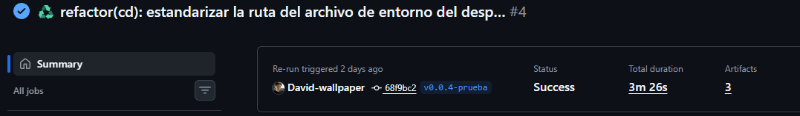
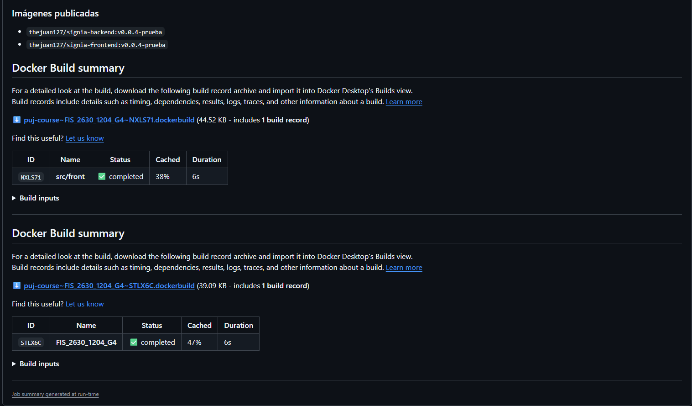
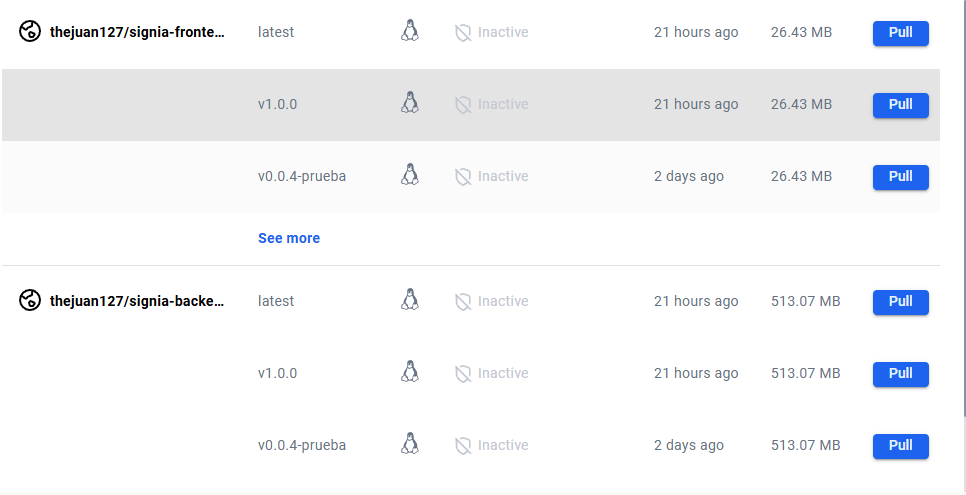
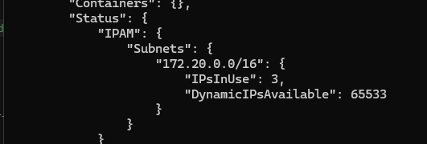

# Pipeline de CD — SignIA

Este documento describe el pipeline de despliegue continuo (CD) de SignIA: cómo se prueban, construyen, versionan y publican las imágenes Docker en Docker Hub, y cómo se despliegan automáticamente con Docker Compose.

- **Workflow:** `.github/workflows/cd.yml`
- **Historia de usuario:** #606

## Resumen del flujo

```
git push origin vX.Y.Z
        │
        ▼
┌──────────────────────┐    ┌──────────────────────────┐    ┌────────────────────────────┐
│ 1. Pruebas del       │───►│ 2. Construir y publicar  │───►│ 3. Desplegar con Docker    │
│    backend           │    │    imágenes              │    │    Compose en WSL          │
│ (backend-ci.yml)     │    │ (runner de GitHub)       │    │ (runner self-hosted)       │
│ Ruff + pytest + 80 % │    │ build + push Docker Hub  │    │ pull + up + verificación   │
└──────────────────────┘    └──────────────────────────┘    └────────────────────────────┘
```

Cada job depende del anterior (`needs`). Si las pruebas fallan, no se publica ninguna imagen; si la publicación falla, no se despliega nada.

## Disparador

```yaml
on:
  push:
    tags:
      - "v*.*.*"
```

El CD **solo** se ejecuta al subir un tag de versión, por ejemplo `v1.0.0`.

| Acción | Qué se ejecuta |
|---|---|
| `git push` a una rama | Solo el CI (Backend CI, Frontend CI, Docker Check, SonarQube, métricas y Telegram) |
| Abrir, actualizar o mergear un pull request | Solo el CI |
| `git push origin vX.Y.Z` | **El CD**: pruebas, publicación y despliegue |

**Justificación:**

- **Versionado:** cada imagen publicada corresponde a una versión del producto. El tag `v1.0.0` produce las imágenes `signia-backend:v1.0.0` y `signia-frontend:v1.0.0`, y el release `v1.0.0` de GitHub.
- **Control:** el equipo decide cuándo sale una versión. No se despliega código sin revisar ni cada commit intermedio.
- **Seguridad:** solo quien tiene permiso de escritura puede subir tags. El CD no escucha `pull_request`, así que un pull request desde un fork no puede ejecutar código en el runner self-hosted.

`concurrency` (grupo `cd-signia`, sin cancelar) hace que, si se publican dos versiones seguidas, la segunda espere a que termine la primera.

## Jobs

### 1. Pruebas del backend

```yaml
pruebas:
  uses: ./.github/workflows/backend-ci.yml
```

Reutiliza el CI del backend (`backend-ci.yml`, que declara `workflow_call` para poder llamarse desde otros workflows):

- revisión de estilo con **Ruff**;
- base de datos PostgreSQL temporal con el esquema, las migraciones y los datos de prueba;
- **pytest** con cobertura mínima del **80 %**;
- reportes de cobertura y de resultados guardados como artefactos.

**Justificación:** el CD no repite la definición de las pruebas. Una versión solo se publica si pasa exactamente los mismos controles que cualquier cambio.

### 2. Construir y publicar imágenes

Corre en un runner de GitHub (`ubuntu-latest`).

| Paso | Qué hace |
|---|---|
| Verificar configuración de Docker Hub | Falla con un mensaje claro si no existe la variable `DOCKERHUB_USUARIO`. |
| Configurar Docker Buildx | Prepara la construcción de imágenes con caché. |
| Iniciar sesión en Docker Hub | Usa la variable `DOCKERHUB_USUARIO` y el secreto `DOCKERHUB_TOKEN`. |
| Construir y publicar el backend | Construye `Dockerfile` (raíz) y publica `thejuan127/signia-backend`. |
| Construir y publicar el frontend | Construye `src/front/Dockerfile` y publica `thejuan127/signia-frontend`. |
| Resumen de la publicación | Escribe en el resumen de la ejecución las imágenes publicadas. |

**Por qué dos imágenes:** el backend (Python y FastAPI) y el frontend (React compilado y servido con nginx) son programas distintos, cada uno con su Dockerfile. PostgreSQL no se construye: usa la imagen oficial `postgres:16`.

**Versionado:** cada imagen se publica con dos etiquetas:

- la versión del tag (por ejemplo `v1.0.0`), que identifica exactamente lo que se publicó;
- `latest`, que apunta a la última versión publicada.

**Caché:** las capas se guardan en la caché de GitHub Actions (`type=gha`), separadas para backend y frontend. El resumen *Docker Build summary* muestra el porcentaje de capas reutilizadas, lo que reduce la construcción de minutos a segundos.

### 3. Desplegar con Docker Compose en WSL

Corre en un **runner self-hosted** con la etiqueta `signia-wsl`, instalado en WSL.

| Paso | Qué hace |
|---|---|
| Descargar la versión publicada | Hace checkout del commit del tag, para usar el `docker-compose.yml` de esa versión. |
| Preparar el archivo de entorno | Copia `~/signia-deploy/.env` de la máquina del runner y le pone permisos `600`. |
| Descargar las imágenes de Docker Hub | `docker compose pull backend frontend`. |
| Desplegar la nueva versión | `docker compose up -d --no-build --remove-orphans --wait --wait-timeout 180`. |
| Verificar el backend | `curl` a `http://localhost:8000/health`, con reintentos. |
| Verificar el frontend | `curl` a `http://localhost:5173/`, con reintentos. |
| Mostrar contenedores y red | `docker compose ps` y los contenedores conectados a `signia_red` con su IP. |
| Resumen del despliegue | Escribe en el resumen la versión desplegada. |
| Eliminar el archivo de entorno | Borra el `.env` copiado **siempre** (`if: always()`), incluso si el despliegue falla. |

**Detalles importantes:**

- `COMPOSE_PROJECT_NAME: fis_2630_1204_g4` es el mismo nombre de proyecto con el que se levanta el sistema manualmente. Así el despliegue **reemplaza** esos contenedores y conserva el volumen de la base de datos, en lugar de chocar con los puertos o la red.
- `--no-build` garantiza que se despliegan las imágenes de Docker Hub y no imágenes construidas en la máquina.
- `--wait` espera a que todos los servicios estén **healthy** según sus healthchecks antes de verificar.
- `--retry-all-errors` en `curl` reintenta también cuando la conexión se corta mientras el servicio termina de arrancar.

**Por qué un runner self-hosted y no un runner de GitHub:** los runners de GitHub son máquinas temporales que se destruyen al terminar el job y no tienen una dirección accesible desde afuera. Sirven para **verificar** (eso hace `docker-check.yml`), pero no para que la aplicación **quede corriendo**. El runner en WSL actualiza el entorno donde el equipo ejecuta SignIA.

## Docker Compose y red

`docker-compose.yml` define tres servicios conectados a una red explícita:

```yaml
networks:
  signia_red:
    name: signia_red
    driver: bridge
```

| Servicio | Imagen | Puerto | Healthcheck |
|---|---|---|---|
| `postgres` | `postgres:16` | 5432 | `pg_isready` |
| `backend` | `${SIGNIA_IMAGEN_BACKEND:-signia-backend}:${SIGNIA_TAG:-dev}` | 8000 | `curl /health` |
| `frontend` | `${SIGNIA_IMAGEN_FRONTEND:-signia-frontend}:${SIGNIA_TAG:-dev}` | 5173 → 80 | `curl /` |

- **Orden de arranque:** `postgres` → `backend` (cuando la base está sana) → `frontend` (cuando el backend está sano), mediante `depends_on` con `condition: service_healthy`.
- **En desarrollo**, sin definir variables, las imágenes se llaman `signia-backend:dev` y `signia-frontend:dev` y se construyen localmente con `build:`.
- **En el CD**, el workflow define `SIGNIA_IMAGEN_BACKEND`, `SIGNIA_IMAGEN_FRONTEND` y `SIGNIA_TAG`, y Compose usa las imágenes publicadas.
- El nombre fijo `signia_red` permite inspeccionar la red con `docker network inspect signia_red`.
- En la validación (`docker-check.yml`), el backend se conecta a la base de datos por el nombre del servicio (`postgres:5432`) a través de esta red. En el despliegue, `DATABASE_URL` apunta a la base de datos definida en el `.env`.

## Secretos y variables

Se configuran en **Settings → Secrets and variables → Actions**. Ningún valor secreto está en el repositorio.

| Nombre | Tipo | Uso |
|---|---|---|
| `DOCKERHUB_USUARIO` | Variable | Usuario de Docker Hub y prefijo de las imágenes. |
| `DOCKERHUB_TOKEN` | **Secreto** | Personal access token de Docker Hub con permisos **Read & Write**. |

El archivo de entorno del despliegue debe estar en **`~/signia-deploy/.env`** en la máquina de cada runner. Contiene, entre otras, `DATABASE_URL`, `POSTGRES_PASSWORD` y las claves de la aplicación. Nunca se sube al repositorio, y `.dockerignore` lo excluye de las imágenes publicadas.

Las imágenes en Docker Hub son **públicas**: contienen el código y las dependencias, pero no los secretos.

## Configuración de un runner self-hosted en WSL

Cualquier integrante del equipo puede registrar su propio runner. El job de despliegue lo toma cualquier runner **encendido** con la etiqueta `signia-wsl`.

### Requisitos

- WSL con una distribución Linux.
- Docker funcionando en WSL **sin `sudo`** (`docker ps` debe responder sin pedir contraseña). Si pide `sudo`, ver [Problemas encontrados](#problemas-encontrados-y-soluciones).
- Permiso de **administrador** del repositorio para registrar el runner (o que alguien con ese permiso genere el comando).
- El `.env` real de SignIA, compartido por un canal privado.
- Los puertos 5432, 8000 y 5173 libres.

No se necesita el token de Docker Hub: las imágenes se descargan sin iniciar sesión.

### Pasos

1. En GitHub: **Settings → Actions → Runners → New self-hosted runner**, sistema **Linux**, arquitectura **x64**.
2. En WSL, crear la carpeta del runner **fuera del repositorio**:

   ```bash
   mkdir -p ~/actions-runner && cd ~/actions-runner
   ```

3. Ejecutar, dentro de esa carpeta, los comandos de la sección **Download** que muestra GitHub.
4. Instalar las dependencias de .NET si aparece el aviso de `libicu`:

   ```bash
   sudo ./bin/installdependencies.sh
   ```

5. Ejecutar el comando de la sección **Configure** (`./config.sh --url ... --token ...`):
   - **Runner group:** Enter;
   - **Name:** un nombre propio (por ejemplo `signia-wsl-nombre`);
   - **Labels:** `signia-wsl`;
   - **Work folder:** Enter (`_work`, dentro de la carpeta del runner; nunca la carpeta del repositorio).

   El token de registro es secreto y expira en una hora.

6. Preparar el archivo de entorno en la ruta estándar. Si el `.env` está en el repositorio, crear un enlace usando la ruta **de Linux** (en WSL, `C:` es `/mnt/c`; `wslpath 'C:/ruta'` la convierte):

   ```bash
   mkdir -p ~/signia-deploy
   ln -s /mnt/c/ruta/al/repositorio/.env ~/signia-deploy/.env
   ```

   Si no, copiarlo y protegerlo:

   ```bash
   mkdir -p ~/signia-deploy
   cp /ruta/al/.env ~/signia-deploy/.env
   chmod 600 ~/signia-deploy/.env
   ```

   Comprobar que el archivo es accesible:

   ```bash
   ls -lL ~/signia-deploy/.env
   ```

7. Encender el runner cuando se vaya a desplegar:

   ```bash
   cd ~/actions-runner
   ./run.sh
   ```

   Debe mostrar `Listening for Jobs` y aparecer como **Idle** en **Settings → Actions → Runners**.

### Reglas de uso

- **Un solo runner encendido** al publicar una versión: el despliegue va a la máquina del runner que tome el job.
- El sistema queda corriendo en la máquina de quien despliega. La base de datos es compartida (Neon).
- Si ningún runner está encendido, el job de despliegue queda en espera y se ejecuta cuando alguno se encienda; GitHub lo cancela a las 24 horas.

## Seguridad

El repositorio es público y el runner self-hosted ejecuta código en una máquina del equipo. Por eso:

- El CD solo se dispara con **tags**, que solo pueden subir los miembros con permiso de escritura. No escucha `pull_request`.
- Los workflows de pull requests de forks requieren **aprobación** (**Settings → Actions → General → Require approval for all external contributors**).
- El job de despliegue es el único que usa la etiqueta `signia-wsl`.
- El runner **no** se instala como servicio permanente: se enciende solo para desplegar y se apaga después (`Ctrl+C`).
- Pertenecer al grupo `docker` da permisos equivalentes a administrador en la máquina; solo se configura en equipos propios.
- El token de Docker Hub se guarda como secreto de GitHub y no aparece en los logs.
- El `.env` se copia solo durante el despliegue y se elimina al terminar.

## Cómo publicar una versión

1. Mergear los pull requests en la rama principal.
2. Encender **un** runner (`./run.sh`).
3. Crear y subir el tag desde la rama actualizada:

   ```bash
   git switch develop
   git pull origin develop
   git tag v1.0.0
   git push origin v1.0.0
   ```

4. Seguir la ejecución en **Actions → CD - Publicar y desplegar SignIA**.
5. Cuando termine en verde, crear el **release** en GitHub: **Releases → Draft a new release**, elegir el tag existente, **Generate release notes** y **Publish release**.

**Numeración:** `vMAYOR.MENOR.PARCHE`. PARCHE para correcciones, MENOR para funcionalidades nuevas y MAYOR para cambios grandes o incompatibles.

**Volver a ejecutar:** **Re-run** repite la ejecución **con el workflow del commit del tag**. Sirve cuando falla algo externo (token, runner apagado, red). Si se cambió `cd.yml`, hay que publicar un **tag nuevo**.

## Cómo reproducir el despliegue manualmente

Desde la carpeta del proyecto en WSL, con el `.env` configurado:

```bash
export SIGNIA_IMAGEN_BACKEND=thejuan127/signia-backend
export SIGNIA_IMAGEN_FRONTEND=thejuan127/signia-frontend
export SIGNIA_TAG=v1.0.0
docker compose -p fis_2630_1204_g4 pull backend frontend
docker compose -p fis_2630_1204_g4 up -d --no-build --wait
docker network inspect signia_red
```

## Problemas encontrados y soluciones

| Problema | Causa | Solución |
|---|---|---|
| `malformed HTTP Authorization header` al iniciar sesión en Docker Hub | El secreto `DOCKERHUB_TOKEN` llegó vacío o incorrecto, o la variable de usuario tenía un valor distinto del usuario real | Generar un token nuevo con permisos **Read & Write**, actualizar el secreto y usar el usuario exacto (`thejuan127`, sin espacios). |
| `libicu` faltante al configurar el runner | WSL no trae la librería ICU que necesita .NET | `sudo ./bin/installdependencies.sh`. |
| `./run.sh: No such file or directory` | El comando se ejecutó fuera de la carpeta del runner | `cd ~/actions-runner` antes de `./run.sh`. |
| `permission denied ... docker.sock` en el runner | El usuario de WSL necesita `sudo` para usar Docker | `sudo usermod -aG docker $USER` y reiniciar WSL (`wsl --shutdown`). |
| `curl: (56) Connection reset by peer` al verificar el frontend | La verificación empezaba antes de que nginx estuviera escuchando | `docker compose up --wait` y `curl --retry-all-errors`. |
| `No se encontró el archivo de entorno indicado en SIGNIA_ENV_ARCHIVO` | Se volvió a ejecutar (Re-run) una versión anterior del workflow, que usaba una ruta propia de una sola máquina | Usar la ruta estándar `~/signia-deploy/.env` y publicar un tag nuevo en lugar de hacer Re-run. |
| Enlace `~/signia-deploy/.env` roto | Se usó una ruta de Windows (`C:/...`) dentro de WSL | Usar la ruta de Linux (`/mnt/c/...`), por ejemplo con `wslpath`. |

## Evidencias

### Ejecución del CD con los tres jobs (`v0.0.4-prueba`)



### Resumen del despliegue



### Imágenes publicadas en Docker Hub



### Red de Docker Compose

