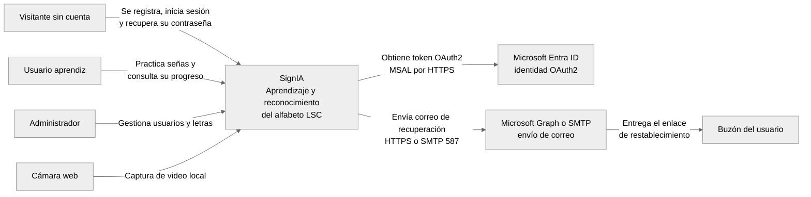
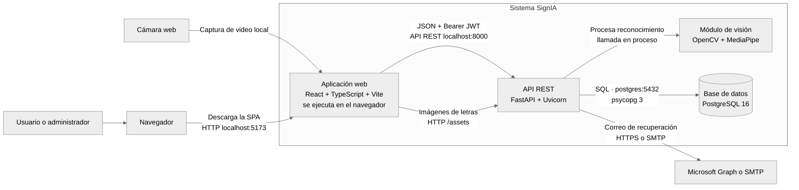
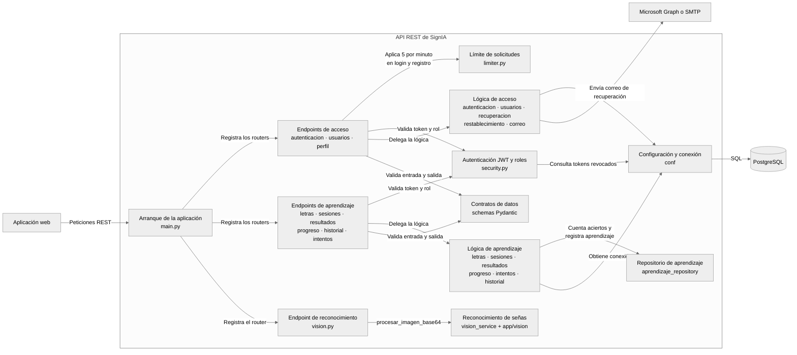
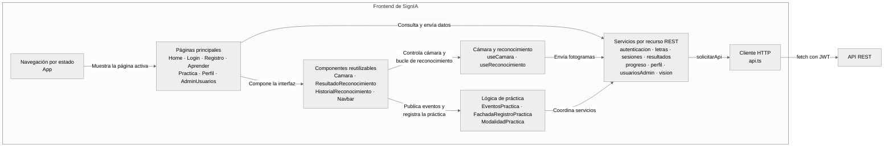

# Arquitectura de SignIA — Modelo C4

Estos diagramas describen la arquitectura general de SignIA con el modelo C4. El nivel 1 presenta el sistema y su entorno, el nivel 2 los contenedores que se ejecutan por separado y el nivel 3 los componentes internos del backend y del frontend. El nivel 4 (código) de cada módulo se documenta en los diagramas de patrones de cada integrante.

## Nivel 1: contexto

SignIA se representa como una sola caja. Las tres personas acceden desde el navegador; los servicios de Microsoft solo intervienen en la recuperación de contraseña.

- **Visitante sin cuenta:** puede registrarse, iniciar sesión y solicitar la recuperación de su contraseña.
- **Usuario aprendiz:** rol `usuario`. Practica el alfabeto con la cámara y consulta su progreso.
- **Administrador:** rol `administrador`. Gestiona usuarios (rol, desactivación, progreso) y edita la información de las letras.
- **Correo:** el transporte por defecto es Microsoft Graph (`CORREO_TRANSPORTE=graph`); SMTP es la ruta alternativa.

## Nivel 2: contenedores

## Contenedores

| Contenedor | Tecnología | Responsabilidad | Comunicación |
|---|---|---|---|
| Aplicación web | React 19, TypeScript, Vite; servida por `nginx:alpine` | Interfaz de aprendizaje, práctica con cámara, perfil y administración | REST hacia la API con JWT en la cabecera `Authorization` |
| API REST | Python 3.12, FastAPI, Uvicorn, PyJWT, slowapi | Autenticación, usuarios, letras, sesiones, resultados, progreso, historial y recuperación | Recibe REST en `8000`; consulta PostgreSQL con SQL |
| Módulo de visión | OpenCV, MediaPipe (`hand_landmarker.task`) | Detecta la mano y reconoce letras estáticas y con movimiento | Llamada en proceso desde `vision_service` |
| Base de datos | PostgreSQL 16, volumen `postgres_data` | Persiste usuarios, letras, sesiones, resultados, intentos, progreso, recuperaciones y tokens revocados | SQL en `postgres:5432`, red interna de Compose |

El módulo de visión se dibuja como contenedor porque tiene una responsabilidad y una tecnología propias, pero **se ejecuta dentro del mismo proceso que la API**. No se despliega por separado ni expone puertos.

## Nivel 3: componentes del backend

El backend sigue el flujo **router → service → base de datos**. Los routers reciben la petición, delegan la autorización en `security.py` y la lógica en los services. Los services ejecutan SQL directo con psycopg; no hay ORM.

- **Endpoints de acceso:** registro, login, logout, recuperación y restablecimiento de contraseña, gestión de usuarios por el administrador y perfil propio.
- **Endpoints de aprendizaje:** consulta y edición de letras, sesiones de práctica, resultados de reconocimiento, progreso, historial e intentos.
- **Endpoint de reconocimiento:** `POST /vision/reconocer` recibe un fotograma en Base64 y devuelve la letra detectada.
- **Seguridad:** emite y valida JWT HS256 con `jti`, rechaza tokens revocados y expone las dependencias `obtener_usuario_actual` y `requerir_administrador`.
- **Reconocimiento de señas:** contiene los patrones Singleton y Strategy, documentados en `PatronesSingletonStrategy.md`.

## Nivel 3: componentes del frontend

El frontend no usa `react-router`: `App` decide qué página mostrar a partir de un estado. Todos los servicios pasan por `api.ts`, que centraliza la URL base (`VITE_API_URL`), la cabecera del token y el manejo de `ErrorApi`.

- **Lógica de práctica:** contiene los patrones Observer y Facade (`PatronesObserverFacade.md`) y Factory Method (`ModalidadPractica`).
- **Estado del cliente:** el JWT y la sesión se guardan en `sessionStorage`; la sesión de reconocimiento, en `localStorage`.

## Decisiones de arquitectura

- **Sin capa de controllers:** los routers de FastAPI llaman directamente a los services. La carpeta `app/controllers/` existe, pero está vacía.
- **SQL directo:** no hay ORM. Los services usan `conf.database.obtener_conexion` y ejecutan las consultas con psycopg 3.
- **Visión en el mismo proceso:** el reconocimiento se ejecuta dentro de la API. Es más simple de desplegar, pero comparte CPU con el resto de endpoints.
- **JWT con revocación:** el token no tiene estado, pero cada uno lleva un `jti` que puede guardarse en `tokens_revocados` para invalidarlo antes de que expire.

## Nota de verificación

Estos diagramas se elaboraron a partir del código de la rama `develop`. El README menciona las carpetas `web/`, `app/controllers/`, `src/models/` y `src/middleware/`, pero el frontend real está en `src/front/srcFront/` y las demás carpetas solo contienen `.gitkeep`. Varios endpoints del backend (`/auth/logout`, `/historial`, `/intentos`, entre otros) están implementados pero el frontend todavía no los consume.
