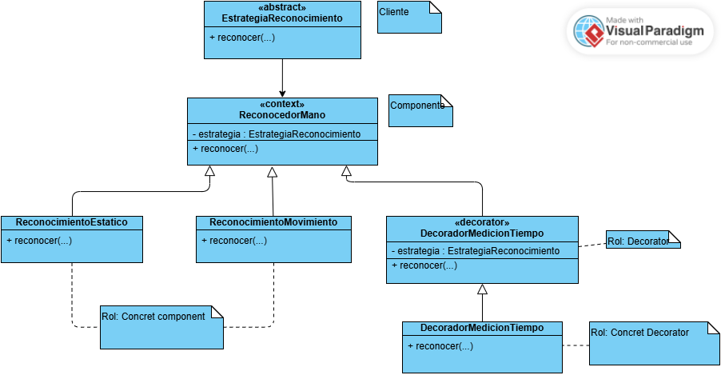

# Diagrama de clases — Patrón Decorator en el reconocimiento de señas



## Descripción

Este diagrama muestra cómo se aplicó el patrón **Decorator** en el módulo de reconocimiento de SignIA para agregar la medición del tiempo de ejecución sin modificar directamente los algoritmos encargados de reconocer las señas.

El reconocimiento de SignIA utiliza un contrato común llamado `EstrategiaReconocimiento`. A partir de este contrato se encuentran las implementaciones `ReconocimientoEstatico` y `ReconocimientoMovimiento`, encargadas de realizar los dos tipos de reconocimiento existentes. Sobre esta misma estructura se incorporó `DecoradorReconocimiento`, que puede envolver cualquier objeto que cumpla el contrato de `EstrategiaReconocimiento`.

`DecoradorMedicionTiempo` extiende este decorador y agrega la medición del tiempo alrededor de la operación `reconocer(...)`. De esta manera, primero conserva la estrategia original, luego ejecuta su reconocimiento y finalmente registra información sobre la duración de la operación. El resultado producido por la estrategia decorada continúa siendo el resultado que recibe el resto del sistema.

Archivos de código relacionados:

- `app/vision/estrategia_reconocimiento.py`, contiene el contrato común utilizado por los reconocedores y decoradores.
- `app/vision/reconocimiento.py`, contiene `ReconocimientoEstatico`, `ReconocimientoMovimiento`, `ReconocedorMano` y la integración del decorador en el flujo de reconocimiento.
- `app/vision/decoradores_reconocimiento.py`, contiene `DecoradorReconocimiento` y `DecoradorMedicionTiempo`.
- `src/tests/test_decoradores_reconocimiento.py`, contiene las pruebas específicas del patrón.
- `src/tests/test_casos_borde_reconocimiento.py`, contiene casos adicionales relacionados con la medición.

## Roles del patrón

| **Rol (GoF)** | **Elemento en SignIA** | **Responsabilidad** |
| --- | --- | --- |
| **Client** | `ReconocedorMano` | Utiliza una estrategia de reconocimiento sin necesitar conocer si esta se encuentra decorada. |
| **Component** | `EstrategiaReconocimiento` | Define la operación común `reconocer(...)` que comparten los componentes y los decoradores. |
| **Concrete Component** | `ReconocimientoEstatico` | Implementa el reconocimiento de señas estáticas. |
| **Concrete Component** | `ReconocimientoMovimiento` | Implementa el reconocimiento de señas que requieren analizar movimiento. |
| **Decorator** | `DecoradorReconocimiento` | Mantiene una referencia a otra `EstrategiaReconocimiento` y permite delegar la operación de reconocimiento. |
| **Concrete Decorator** | `DecoradorMedicionTiempo` | Agrega la medición del tiempo de ejecución alrededor del reconocimiento original. |

## Notación

- **`«abstract»`** se utiliza para representar `EstrategiaReconocimiento`, debido a que define el contrato que deben cumplir las diferentes implementaciones.
- **`«decorator»`** identifica a `DecoradorReconocimiento` como la clase base encargada de envolver otra estrategia.
- `ReconocimientoEstatico` y `ReconocimientoMovimiento` representan los componentes concretos.
- `DecoradorMedicionTiempo` representa el decorador concreto.
- `ReconocedorMano` aparece como cliente porque puede trabajar con cualquier objeto que cumpla el contrato `EstrategiaReconocimiento`.

## Elementos

### `EstrategiaReconocimiento`

Representa el componente general del patrón. Define la operación que deben ofrecer tanto los reconocedores normales como los decoradores.

| **Operación** | **Qué hace** |
| --- | --- |
| `reconocer(mano, fotogramas) : dict` | Define la operación común utilizada para realizar el reconocimiento de una seña. |

Al utilizar este contrato común, un decorador puede utilizarse en el mismo lugar donde normalmente se utilizaría una estrategia de reconocimiento.

### `ReconocimientoEstatico`

Es uno de los componentes concretos del patrón. Implementa `EstrategiaReconocimiento` y se encarga del reconocimiento de las señas estáticas.

| **Operación** | **Qué hace** |
| --- | --- |
| `reconocer(mano, fotogramas) : dict` | Ejecuta el reconocimiento estático y devuelve el resultado correspondiente. |

Esta clase mantiene su responsabilidad original y no necesita incluir lógica relacionada con métricas o medición de tiempo.

### `ReconocimientoMovimiento`

Es el segundo componente concreto. También implementa el mismo contrato de reconocimiento, pero utiliza la información de los fotogramas para identificar señas que requieren movimiento.

| **Operación** | **Qué hace** |
| --- | --- |
| `reconocer(mano, fotogramas) : dict` | Ejecuta el reconocimiento correspondiente a las señas con movimiento. |

Al compartir el mismo contrato con `ReconocimientoEstatico`, cualquiera de los dos puede ser utilizado como componente interno de un decorador.

### `DecoradorReconocimiento`

Representa el Decorator base. Hereda de `EstrategiaReconocimiento`, por lo que puede utilizarse como cualquier otra estrategia, pero además mantiene una referencia a otra estrategia que se encuentra decorando.

| **Elemento** | **Qué hace** |
| --- | --- |
| `estrategia : EstrategiaReconocimiento` | Mantiene la referencia al componente que está siendo decorado. |
| `reconocer(mano, fotogramas) : dict` | Permite delegar el reconocimiento en la estrategia almacenada. |

Esta clase es la parte que permite aplicar el patrón sin alterar las implementaciones originales de reconocimiento.

### `DecoradorMedicionTiempo`

Representa el Concrete Decorator implementado en SignIA. Hereda de `DecoradorReconocimiento` y agrega la responsabilidad de medir cuánto tarda la operación de reconocimiento.

| **Operación** | **Qué hace** |
| --- | --- |
| `reconocer(mano, fotogramas) : dict` | Ejecuta la estrategia decorada, mide la duración de la operación y conserva el resultado original. |

La medición se realiza alrededor de la llamada al componente decorado. Por esta razón, las estrategias concretas pueden seguir concentradas únicamente en reconocer las señas.

### Cliente

`ReconocedorMano` recibe una `EstrategiaReconocimiento` y delega en ella la operación `reconocer(...)`. Debido a que `DecoradorReconocimiento` también cumple ese mismo contrato, el contexto puede recibir una estrategia normal o una estrategia decorada sin cambiar su forma de uso.

Esta relación permite integrar `DecoradorMedicionTiempo` en el flujo existente sin modificar la responsabilidad principal de `ReconocedorMano`.

## Relaciones

| **Relación** | **Tipo** | **Significado** |
| --- | --- | --- |
| `ReconocedorMano` → `EstrategiaReconocimiento` | Asociación dirigida, rol `estrategia`, multiplicidad `1` | El cliente mantiene la estrategia que utiliza para realizar el reconocimiento. |
| `ReconocimientoEstatico` → `EstrategiaReconocimiento` | Generalización | El componente concreto implementa el contrato común. |
| `ReconocimientoMovimiento` → `EstrategiaReconocimiento` | Generalización | El componente concreto implementa el mismo contrato. |
| `DecoradorReconocimiento` → `EstrategiaReconocimiento` | Generalización | El decorador conserva la misma interfaz que los componentes que envuelve. |
| `DecoradorReconocimiento` → `EstrategiaReconocimiento` | Asociación dirigida, rol `estrategia`, multiplicidad `1` | El decorador mantiene una referencia al componente decorado. |
| `DecoradorMedicionTiempo` → `DecoradorReconocimiento` | Generalización | El decorador concreto extiende el comportamiento definido por el decorador base. |

La relación más importante del patrón se encuentra en `DecoradorReconocimiento`: esta clase hereda de `EstrategiaReconocimiento` y, al mismo tiempo, contiene una referencia a otra `EstrategiaReconocimiento`. Esto permite que el decorador tenga la misma interfaz que el objeto que envuelve.

## Funcionamiento del patrón

El flujo comienza con una estrategia concreta, por ejemplo `ReconocimientoEstatico` o `ReconocimientoMovimiento`. Esa estrategia puede utilizarse directamente o puede entregarse a `DecoradorMedicionTiempo`.

El decorador conserva internamente la estrategia original y, cuando recibe una llamada a `reconocer(...)`, agrega su comportamiento antes y después de delegar la operación. En este caso, el comportamiento adicional consiste en medir el tiempo que tarda el reconocimiento.

El flujo puede representarse de la siguiente manera:

```text
ReconocedorMano
      |
      v
DecoradorMedicionTiempo
      |
      v
ReconocimientoEstatico
      |
      v
Resultado
```

o:

```text
ReconocedorMano
      |
      v
DecoradorMedicionTiempo
      |
      v
ReconocimientoMovimiento
      |
      v
Resultado
```

El cliente continúa trabajando con una `EstrategiaReconocimiento`, mientras que la medición queda agregada alrededor del componente original.

## Por qué se utiliza Decorator

La medición del tiempo es una responsabilidad adicional al reconocimiento de la seña. Incluir esta lógica directamente dentro de `ReconocimientoEstatico` y `ReconocimientoMovimiento` obligaría a repetir el mismo comportamiento y mezclaría la medición con los algoritmos encargados de identificar las letras.

Con `DecoradorMedicionTiempo`, la medición queda separada y puede aplicarse sobre distintas estrategias que compartan el contrato `EstrategiaReconocimiento`. Además, el reconocimiento original puede continuar funcionando sin depender directamente de la lógica utilizada para registrar las métricas.

## Pruebas

Las pruebas relacionadas con el patrón se encuentran principalmente en `test_decoradores_reconocimiento.py` y se complementan con los casos de borde del módulo de reconocimiento.

Entre los comportamientos evaluados se encuentran:

- que el decorador ejecute la estrategia que tiene envuelta;
- que se conserve el resultado producido por la estrategia original;
- que la medición se registre alrededor de la ejecución;
- que una duración de `0 ms` pueda manejarse correctamente;
- que los errores producidos por la estrategia original no sean ocultados por el decorador;
- que ante un error también pueda registrarse el estado correspondiente de la medición.

Estas pruebas permiten comprobar que el comportamiento agregado por el decorador no modifica la responsabilidad ni el resultado esperado del componente original.

## Elementos omitidos

| **Omitido** | **Motivo** |
| --- | --- |
| `GestorDetectoresCompartido` | Pertenece al patrón Singleton y administra los detectores utilizados por el módulo de visión. |
| `DetectorMano` | Participa antes del reconocimiento, pero no forma parte de la estructura del patrón Decorator. |
| Funciones de reconocimiento individual de letras | Son utilizadas internamente por los componentes concretos y no participan directamente en el patrón. |
| MediaPipe | Es utilizado durante la detección de la mano, pero no forma parte del Decorator. |
| OpenCV | Se utiliza para el procesamiento de imágenes y no interviene en la relación entre componente y decorador. |
| Servicios de sesiones, resultados y progreso | Se ejecutan en otras partes del flujo y no participan en la decoración del reconocimiento. |

El diagrama se concentra en mostrar que `DecoradorReconocimiento` conserva el mismo contrato de `EstrategiaReconocimiento`, mantiene una referencia a otra estrategia y permite que `DecoradorMedicionTiempo` agregue comportamiento alrededor del reconocimiento sin modificar los componentes concretos.