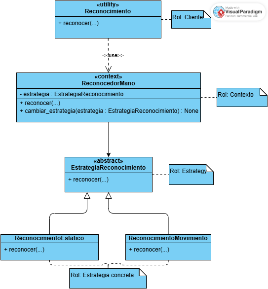

# Diagrama de clases — Patrón Strategy en el reconocimiento de señas

## Descripción

Este diagrama muestra cómo se aplicó el patrón **Strategy** en el módulo de visión de SignIA para separar las diferentes formas de realizar el reconocimiento de señas.

Durante el reconocimiento existen señas que pueden identificarse utilizando únicamente la posición actual de la mano y otras que necesitan analizar una secuencia de movimiento. Para evitar concentrar ambos comportamientos dentro de una misma clase, se definió `EstrategiaReconocimiento` como contrato común y se crearon las estrategias `ReconocimientoEstatico` y `ReconocimientoMovimiento`.

`ReconocedorMano` funciona como el contexto del patrón. Esta clase mantiene una referencia a una estrategia y delega en ella la operación de reconocimiento. Además, permite cambiar la estrategia utilizada sin modificar el funcionamiento general del contexto.

Archivos de código relacionados:

- `app/vision/estrategia_reconocimiento.py`, contiene la estructura principal del patrón Strategy.
- `app/vision/reconocimiento.py`, contiene elementos utilizados durante el reconocimiento de la mano.
- `app/vision/letras_estaticas.py`, contiene lógica relacionada con el reconocimiento de señas estáticas.
- `app/vision/letras_movimiento.py`, contiene lógica relacionada con las señas que necesitan movimiento.
- `src/tests/test_estrategias_reconocimiento.py`, contiene las pruebas de las estrategias y del cambio de comportamiento.

## Roles del patrón

| **Rol (GoF)** | **Elemento en SignIA** | **Responsabilidad** |
| --- | --- | --- |
| **Client** | `reconocimiento` | Utiliza el contexto para iniciar el reconocimiento de una seña. |
| **Context** | `ReconocedorMano` | Mantiene la estrategia actual y delega en ella la operación de reconocimiento. |
| **Strategy** | `EstrategiaReconocimiento` | Define la operación común que deben implementar las diferentes estrategias. |
| **Concrete Strategy** | `ReconocimientoEstatico` | Implementa el reconocimiento utilizado para señas estáticas. |
| **Concrete Strategy** | `ReconocimientoMovimiento` | Implementa el reconocimiento utilizado para señas que necesitan analizar movimiento. |

## Notación

- **`«utility»`** se utiliza para representar el módulo `reconocimiento`, ya que corresponde a un módulo de Python y no a una clase.
- **`«context»`** identifica a `ReconocedorMano` como el elemento que utiliza una estrategia durante el reconocimiento.
- **`«abstract»`** representa a `EstrategiaReconocimiento`, debido a que define el comportamiento común que deben implementar las estrategias concretas.
- `ReconocimientoEstatico` y `ReconocimientoMovimiento` son las estrategias concretas del patrón.
