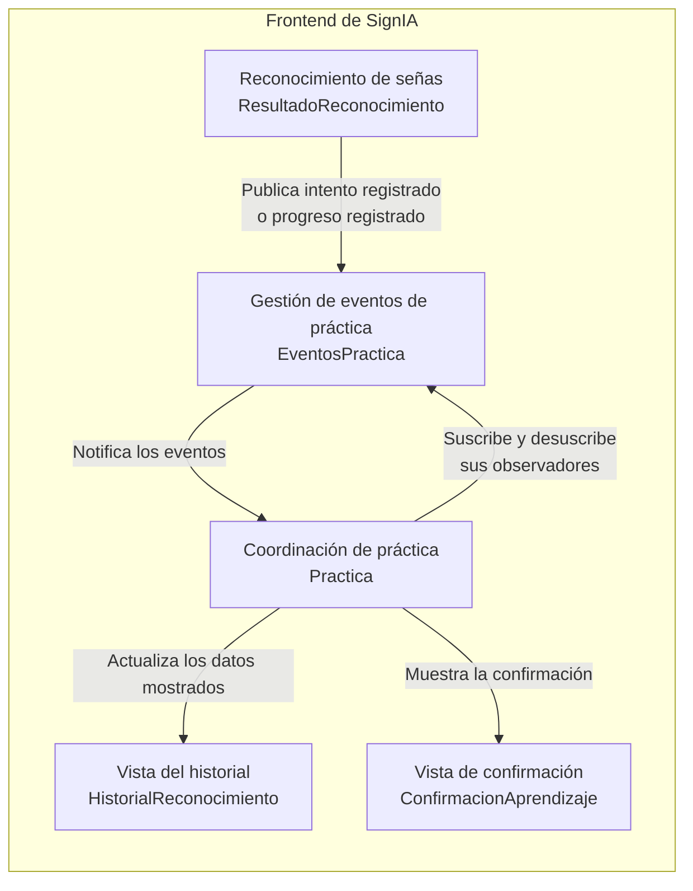
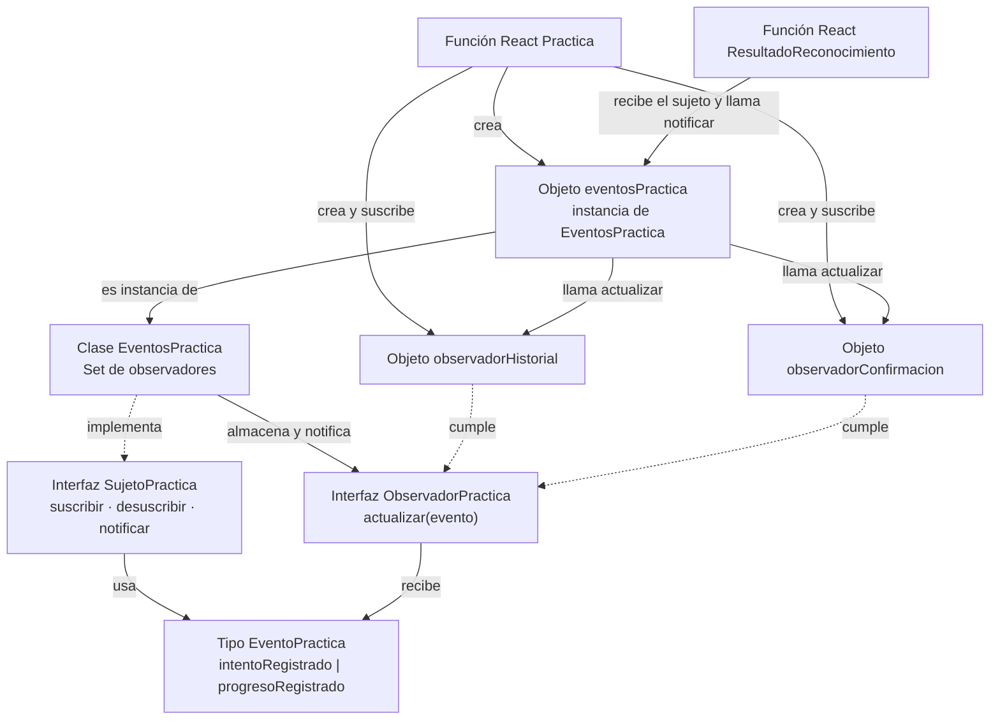
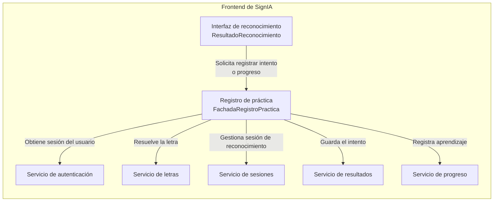
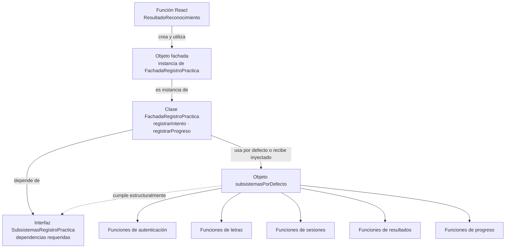

# Patrones de diseño en SignIA: Observer y Facade

Estos diagramas se centran en el frontend de SignIA. Para cada patrón se presenta una vista de nivel 3 (componentes) y una de nivel 4 (código) del modelo C4.

## Observer — eventos de práctica

### Nivel 3: componentes

`ResultadoReconocimiento` publica un evento después de guardar un intento y otro después de registrar correctamente el progreso. `Practica` coordina las reacciones: actualiza el historial o muestra la confirmación de aprendizaje. Las vistas de historial y confirmación no son observadores por sí mismas; muestran el estado que gestiona `Practica`.

### Nivel 4: código

- **Sujeto observado:** la instancia `eventosPractica` de la clase `EventosPractica`.
- **Observadores:** los objetos `observadorHistorial` y `observadorConfirmacion`, creados dentro de `Practica`.
- **Contrato:** `SujetoPractica` define la suscripción y notificación; `ObservadorPractica` define `actualizar`.
- **Emisor:** `ResultadoReconocimiento` llama a `notificar`, pero no es el sujeto ni un observador.

Los observadores se desuscriben durante la limpieza del efecto de React. Así se evita que una instancia de práctica ya desmontada siga reaccionando a eventos.

## Facade — registro de práctica

### Nivel 3: componentes

La fachada ofrece al componente de reconocimiento una entrada más simple para registrar la práctica. La coordinación de autenticación, letras, sesiones, resultados y progreso queda concentrada en `FachadaRegistroPractica`, mientras los servicios existentes conservan sus responsabilidades.

### Nivel 4: código

- **Cliente:** `ResultadoReconocimiento`, que utiliza la fachada.
- **Fachada:** la clase `FachadaRegistroPractica` y su instancia.
- **Subsistemas:** las funciones de los servicios existentes. No se crearon clases nuevas para ellos.
- **Contrato de dependencias:** `SubsistemasRegistroPractica` describe las funciones que necesita la fachada. La clase depende de esa interfaz, pero no la implementa; `subsistemasPorDefecto` es el objeto que cumple su estructura.

La fachada simplifica la coordinación, pero no convierte el guardado del intento y del progreso en una transacción única. El intento puede quedar registrado aunque falle una operación posterior de progreso.

## Diferencia entre los patrones

Observer desacopla la comunicación de eventos: quien publica un resultado no necesita conocer las reacciones de cada observador. Facade simplifica la coordinación de servicios: el componente de reconocimiento no necesita ejecutar directamente cada paso del registro de práctica.
