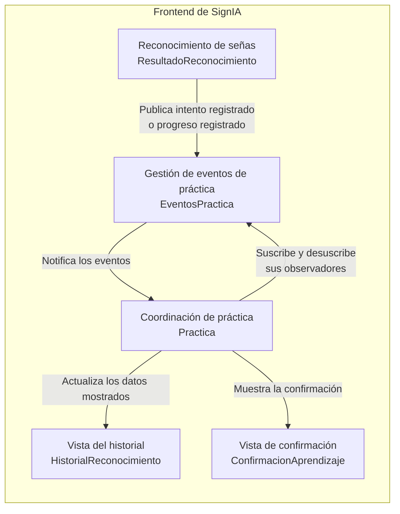
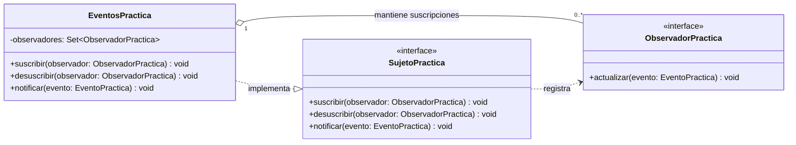
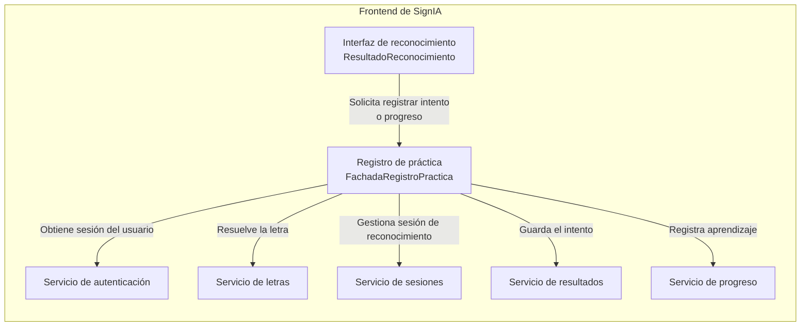
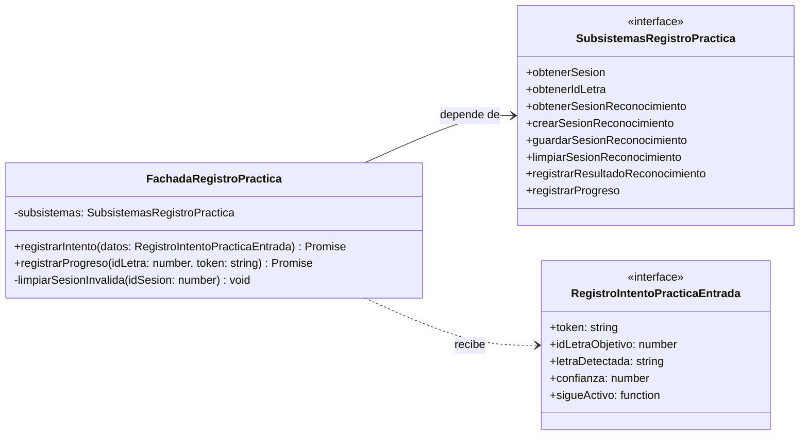

# Patrones de diseño en SignIA: Observer y Facade

Estos diagramas se centran en el frontend de SignIA. Para cada patrón se presenta una vista de nivel 3 (componentes) y una de nivel 4 (código) del modelo C4. Las vistas de nivel 4 se representan mediante diagramas de clases Mermaid y muestran únicamente clases e interfaces existentes en el código.

## Observer — eventos de práctica

### Nivel 3: componentes

`ResultadoReconocimiento` publica un evento después de guardar un intento y otro después de registrar correctamente el progreso. `Practica` coordina las reacciones: actualiza el historial o muestra la confirmación. Las vistas no son observadores directos.

### Nivel 4: diagrama de clases

`EventosPractica` es la clase concreta que implementa `SujetoPractica`. Almacena referencias a elementos que cumplen `ObservadorPractica` y llama a `actualizar` al notificarlos. `EventoPractica` es un **tipo unión de TypeScript**, no una clase, por eso aparece en las firmas pero no como clase del diagrama.

Los observadores concretos del proyecto, `observadorHistorial` y `observadorConfirmacion`, son **objetos literales creados dentro de la función React `Practica`**. Tampoco se dibujan como clases porque no lo son. `ResultadoReconocimiento` es otra función React: origina la notificación, pero no implementa ninguna de estas interfaces.

## Facade — registro de práctica

### Nivel 3: componentes

`FachadaRegistroPractica` coordina funciones de los servicios existentes. `ResultadoReconocimiento` utiliza sus operaciones públicas en lugar de coordinar directamente esos pasos para el registro de práctica.

### Nivel 4: diagrama de clases

`FachadaRegistroPractica` es la clase del patrón. Sus métodos públicos `registrarIntento` y `registrarProgreso` forman la interfaz simplificada que utiliza el cliente.

`SubsistemasRegistroPractica` **no es una interfaz implementada por la fachada**: describe las funciones de servicio que la fachada necesita como dependencias. `RegistroIntentoPracticaEntrada` define los datos de entrada de `registrarIntento`. Las funciones de los servicios y el objeto `subsistemasPorDefecto` no se dibujan como clases porque no lo son.

La fachada simplifica la coordinación, pero no convierte el guardado del intento y del progreso en una transacción única. El intento puede quedar registrado aunque falle una operación posterior de progreso.

## Diferencia entre los patrones

Observer desacopla la comunicación de eventos: quien origina un evento no necesita conocer las reacciones de cada observador. Facade simplifica la coordinación de servicios: el cliente utiliza operaciones de la fachada en lugar de ejecutar directamente cada paso del registro de práctica.
