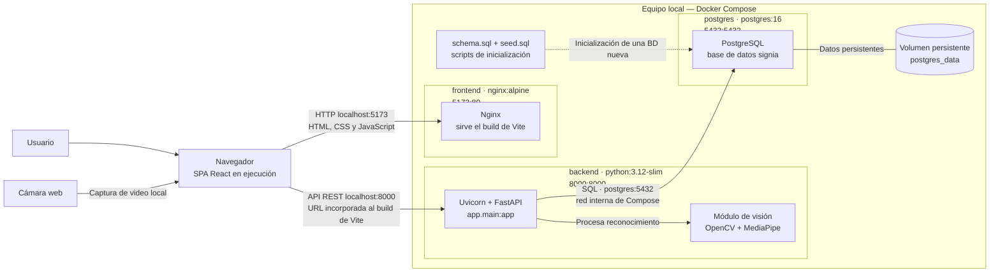

# Diagrama de despliegue — SignIA

SignIA se ejecuta localmente mediante `docker compose up --build`. Docker Compose inicia tres contenedores: frontend, backend y PostgreSQL. La aplicación React se descarga desde el frontend, pero **se ejecuta en el navegador del usuario**.

## Servicios

| Servicio | Imagen o build | Puerto host:contenedor | Función |
|---|---|---|---|
| `frontend` | `src/front/Dockerfile` · `nginx:alpine` | `5173:80` | Entrega los archivos estáticos generados por Vite. |
| `backend` | `Dockerfile` de la raíz · `python:3.12-slim` | `8000:8000` | Expone la API FastAPI y ejecuta el reconocimiento. |
| `postgres` | `postgres:16` | `5432:5432` | Almacena los datos de SignIA. |

## Conexiones y persistencia

- El navegador obtiene la SPA desde `http://localhost:5173`.
- La SPA realiza las solicitudes REST **desde el navegador** hacia la dirección configurada mediante `VITE_API_URL`, indicada aquí como `http://127.0.0.1:8000`. Nginx no actúa como intermediario de esas solicitudes en este diagrama.
- El backend accede a PostgreSQL mediante el nombre interno `postgres` y el puerto `5432`. Para esa conexión no necesita utilizar el puerto publicado en el host.
- La cámara entrega video al navegador. La aplicación puede enviar fotogramas al backend para el reconocimiento.
- Los datos de PostgreSQL persisten en el volumen nombrado `postgres_data`. Los scripts `database/schema.sql` y `database/seed.sql` inicializan una base nueva según la configuración de Compose.

## Orden de arranque

Si `docker-compose.yml` declara las dependencias con `condition: service_healthy`, el arranque se encadena así:

`postgres` saludable → inicia `backend` → `backend` saludable → inicia `frontend`.

`depends_on` controla el **orden de inicio**; no representa las conexiones HTTP o SQL del diagrama ni garantiza por sí solo que un servicio permanezca disponible.

## Nota de verificación

Este diagrama se elaboró con la configuración proporcionada. Antes de publicarlo como descripción exacta del despliegue, conviene cotejar `docker-compose.yml` y los Dockerfiles, especialmente los `healthcheck`, la instalación de `curl`, la configuración de `VITE_API_URL` durante el build y el montaje de los scripts de inicialización. No publiques credenciales reales de `DATABASE_URL`.
