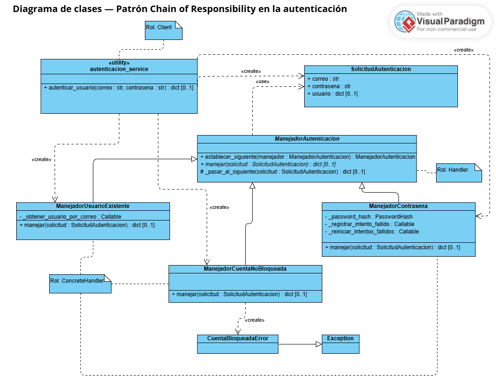

    # Diagrama de clases — Patrón Chain of Responsibility en la autenticación



## Descripción

Este diagrama muestra cómo se aplicó el patrón **Chain of Responsibility** a las validaciones del inicio de sesión del backend de SignIA.

Antes del cambio, `autenticar_usuario` hacía todas las validaciones en una sola función, con condicionales en secuencia. Ahora cada validación es un **manejador** independiente. `autenticar_usuario` arma la cadena y le entrega la solicitud: cada manejador **la rechaza o la pasa al siguiente**.

Archivos de código relacionados:

- `app/services/cadena_autenticacion.py`: los manejadores, la solicitud y `CuentaBloqueadaError`.
- `app/services/autenticacion_service.py`: el cliente, que arma la cadena en `autenticar_usuario`.
- `src/tests/test_cadena_autenticacion.py`: las pruebas de la cadena.

## Roles del patrón

| Rol (GoF) | Elemento en SignIA | Responsabilidad |
|---|---|---|
| **Handler** | `ManejadorAutenticacion` (abstracta) | Define `manejar` y guarda la referencia al siguiente manejador. |
| **ConcreteHandler** | `ManejadorUsuarioExistente`, `ManejadorCuentaNoBloqueada`, `ManejadorContrasena` | Cada uno hace una sola validación. |
| **Client** | `autenticacion_service` (`autenticar_usuario`) | Arma la cadena y le entrega la solicitud. |
| **Solicitud** | `SolicitudAutenticacion` | Datos que recorren la cadena: correo, contraseña y usuario encontrado. |

## Notación

- **`«utility»`** es el estereotipo estándar de UML para un elemento sin instancias cuyas operaciones son todas estáticas. Representa un **módulo de Python con funciones**: `autenticacion_service` no es una clase.
- `ManejadorAutenticacion` y su operación `manejar` aparecen en cursiva porque son **abstractas**.
- `#` indica un método de uso interno de la jerarquía (`_pasar_al_siguiente`).

## Elementos

### `ManejadorAutenticacion` (abstracta)

| Miembro | Descripción |
|---|---|
| `_siguiente : ManejadorAutenticacion [0..1]` | Referencia al siguiente manejador de la cadena, representada con la autoasociación `_siguiente` del diagrama. Empieza en `None`: el último manejador no tiene siguiente. |
| `establecer_siguiente(manejador)` | Guarda el siguiente manejador y lo devuelve, para encadenar: `a.establecer_siguiente(b).establecer_siguiente(c)`. |
| `manejar(solicitud)` | Operación abstracta que implementa cada manejador concreto. |
| `_pasar_al_siguiente(solicitud)` | Entrega la solicitud al siguiente manejador. Si no hay siguiente, devuelve `None`: la cadena **rechaza por defecto**. |

### Manejadores concretos

| Manejador | Validación | Si falla | ¿Registra intento fallido? |
|---|---|---|---|
| `ManejadorUsuarioExistente` | Busca el usuario por correo con la función inyectada `_obtener_usuario_por_correo`. | Devuelve `None`. | No |
| `ManejadorCuentaNoBloqueada` | Revisa que `bloqueado_hasta` no esté en el futuro. | Lanza `CuentaBloqueadaError` (la ruta responde 423). | No |
| `ManejadorContrasena` | Verifica la contraseña con `_password_hash`. | Registra el intento con `_registrar_intento_fallido` y devuelve `None`. | Sí |

`ManejadorContrasena` es el **último eslabón**: si la contraseña es correcta, reinicia los intentos con `_reiniciar_intentos_fallidos` y devuelve el usuario **sin** `contrasena_hash`.

### `SolicitudAutenticacion`

Tiene `correo`, `contrasena` y `usuario` (el que encuentra el primer manejador). `contrasena` y `usuario` se excluyen del `repr` para no exponer la contraseña ni el hash si la solicitud llega a un registro.

### `CuentaBloqueadaError`

Excepción que hereda de `Exception`. Está definida en `cadena_autenticacion.py` y `autenticacion_service.py` la reexporta, así que la ruta de login la sigue importando desde el servicio.

## Orden de la cadena

`autenticar_usuario` arma la cadena en este orden:

```
ManejadorUsuarioExistente → ManejadorCuentaNoBloqueada → ManejadorContrasena
```

El orden mantiene el comportamiento anterior: una cuenta bloqueada se rechaza **antes** de verificar la contraseña y sin sumar un intento fallido.

## Relaciones

| Relación | Tipo | Significado |
|---|---|---|
| `ManejadorAutenticacion` → `ManejadorAutenticacion` | Autoasociación dirigida, rol `_siguiente`, multiplicidad `0..1` | Cada manejador conoce al siguiente de la cadena. Es la relación que forma la cadena. |
| Manejadores concretos → `ManejadorAutenticacion` | Generalización | Los tres heredan de la clase abstracta. |
| `ManejadorAutenticacion` → `SolicitudAutenticacion` | Dependencia `«use»` | `manejar` recibe la solicitud. |
| `ManejadorCuentaNoBloqueada` → `CuentaBloqueadaError` | Dependencia `«create»` | La crea y la lanza. |
| `CuentaBloqueadaError` → `Exception` | Generalización | Es una excepción de Python. |
| `autenticacion_service` → los tres manejadores concretos | Dependencia `«create»` | `autenticar_usuario` crea los manejadores y arma la cadena. |
| `autenticacion_service` → `SolicitudAutenticacion` | Dependencia `«create»` | `autenticar_usuario` crea la solicitud. |

## Decisiones de diseño

- **Las dependencias se inyectan.** Las funciones de base de datos y `password_hash` se pasan por el constructor de cada manejador. Así la cadena no importa `autenticacion_service` (no hay importación circular) y cada manejador se prueba con dobles.
- **La cadena rechaza por defecto.** Si se arma sin el último eslabón, `_pasar_al_siguiente` devuelve `None` y nadie se autentica por error. Solo `ManejadorContrasena` construye el usuario autenticado.
- **Se conservan las pruebas existentes.** `autenticar_usuario` busca las funciones de su módulo en cada llamada y se las pasa a la cadena, así que los `patch` de `test_autenticacion.py` y `test_restablecimiento.py` siguen funcionando sin cambios.
- **El comportamiento no cambió.** Las respuestas de `/auth/login` (200, 401, 423, 429 y 500) son las mismas.

## Pruebas

`src/tests/test_cadena_autenticacion.py` tiene 13 pruebas. Comprueban:

- que `establecer_siguiente` permite encadenar;
- que una cadena sin el último eslabón rechaza por defecto;
- que la cadena se detiene en el primer manejador que rechaza (un manejador espía confirma que el siguiente no se ejecuta);
- cada manejador por separado, incluida la contraseña incorrecta y el hash no utilizable;
- que una cuenta bloqueada no verifica la contraseña ni registra intentos;
- que el `repr` de la solicitud no expone la contraseña ni el hash;
- que `CuentaBloqueadaError` es la misma clase en los dos módulos.

## Elementos omitidos

| Omitido | Motivo |
|---|---|
| Ruta `app/routes/autenticacion.py` | Llama a `autenticar_usuario` y traduce el resultado a HTTP; no participa en el patrón. |
| `obtener_usuario_por_correo`, `registrar_intento_fallido`, `reiniciar_intentos_fallidos` | Son funciones del servicio que se inyectan en los manejadores; aparecen como atributos `Callable`. |
| `PasswordHash` | Clase de la librería `pwdlib`; aparece solo como tipo de `_password_hash`. |